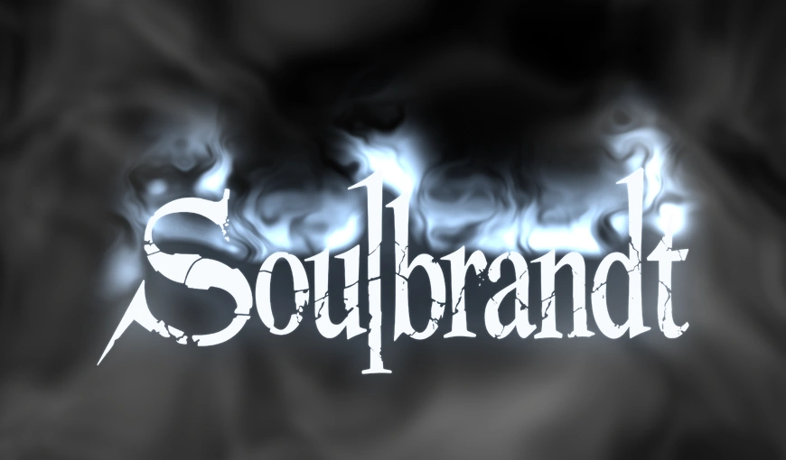

<div align="center">

<picture>
  <source srcset="assets/brand/soulbrandt-title.avif" type="image/avif">
  
</picture>

**Demon's Souls, running natively on PC.**

<a href="https://recomplauncher.com/game/soulbrandt"><picture><source media="(prefers-color-scheme: dark)" srcset="https://recomplauncher.com/assets/press/launcher/badge-light.svg"></picture></a>

[](https://github.com/JonathanDC64/Soulbrandt/releases/latest)
[](https://github.com/JonathanDC64/Soulbrandt/releases/latest)
[](https://github.com/JonathanDC64/Soulbrandt/stargazers)
[](LICENSE)
[](https://github.com/JonathanDC64/Soulbrandt/commits/master)
[](https://github.com/JonathanDC64/Soulbrandt/issues)
[](https://discord.gg/BzmwDeca8s)

[](#what-you-need)
[](#linux)
[](#linux)
[](#features)
[](#features)

**[Download the latest release](https://github.com/JonathanDC64/Soulbrandt/releases/latest)** · [How to play](#how-to-play) · [What you need](#what-you-need) · [Release notes](https://github.com/JonathanDC64/Soulbrandt/releases) · [Build from source](#building-from-source) · [Report an issue](#problems)

</div>

Soulbrandt is a PC port of *Demon's Souls* (PS3, 2009). The game's original code has been converted to run directly on Windows and Linux, with no emulator.

You need your own copy of the game: the US version, **BLUS30443**, or the European version, **BLES00932** (both version 1.00, on disc or from the PlayStation Store), or the Japanese or Asian disc, **BCJS30022** or **BCAS20071**, with its 1.04 update. This project includes no game files.

## Status

**0.2.0, the current release, is an alpha.** Download it from the [Releases](https://github.com/JonathanDC64/Soulbrandt/releases) page.

The game plays from start to finish (a tester has beaten it), but not every part has been tried on every setting, so expect bugs. Seamless co-op is new in 0.2.0 and still being tested. What [isn't supported yet](#not-supported-yet) is below; please [report](#problems) anything you find. Questions and help: [Discord](https://discord.gg/BzmwDeca8s).

## Highlights

- Up to 240 fps or unlocked, with the game's timing fixed. Up to 4K, ultrawide, 16:10 and HDR.
- The US, European, Japanese and Asian versions, each with its languages, plus Japanese on the US disc and Japanese, Chinese and Korean on the European disc.
- Online play on this project's own server: messages, bloodstains, ghosts, co-op, invasions and the Pantheon.
- Seamless co-op (still being tested): play the whole game with up to three friends in the host's world, joined with a room code. No port forwarding needed.
- Mods: put mods for the PS3 game or RPCS3 in the mods folder and turn each one on or off. The game's own files are never changed.
- Roll in any direction while locked on, not only forward, back, left or right.
- At the Nexus statue (optional): a stat respec that gives back the souls your levels cost, and a new appearance, name, body or world tendency.
- Keyboard and mouse, and most controllers: Xbox, DualSense, DualShock 4, Switch Pro, Switch 2 Pro (USB), 8BitDo, the Steam Controller and others.

## Features

Press **F1** (or **L3 + R3** on a controller, or Select + Start: Settings > Interface > Gamepad menu buttons) at any time to open the menu. Most settings apply right away. Each setting has a short help text in the menu.

**Picture**
- Frame rates of 30 (the original), 60, 120, 144, 165 or 240 fps, a number of your own, or unlocked. The game's timing is fixed so it still plays the way it should. Above 60 fps is less tested.
- Cutscenes play at 30 fps by default, as in the original. You can play them at your frame rate instead, with their camera smoothed so they don't judder (Settings > Display > Cutscene frame rate).
- V-sync on or off, "Even frames" for smooth motion, and G-Sync / FreeSync.
- A frame rate counter, with a graph of frame times if you like, to see how a mod or a setting runs (Settings > Display > Frame rate counter). Off by default.
- Render resolution from 50% (for handhelds) up to 300% (4K), ultrawide aspect ratios (21:9 and 32:9), and 16:10 for the Steam Deck's screen.
- Anti-aliasing (FXAA or SMAA), anisotropic filtering up to 16x, texture filtering and a sharp scaling filter.
- HDR on HDR displays, with settings for brightness, peak and shadows. On Linux: a Steam Deck OLED in Game Mode, or a desktop with HDR on for the display (KDE Plasma 6).
- Turn off the game's depth of field and motion blur.
- Window, borderless fullscreen, or exclusive fullscreen on Windows (Settings > Display > Display mode). Alt+Enter switches.
- Two renderers (Settings > Display > Renderer): DirectX 12 and Vulkan. Windows starts on DirectX 12, except with a GeForce GTX 10 series card or older, which starts on Vulkan. Linux starts on Vulkan.

**Controls**
- Xbox controllers, DualSense, DualShock 4, Switch Pro, Switch 2 Pro (over USB), 8BitDo, the Steam Controller and most other gamepads, over USB or Bluetooth, with vibration. With several connected, **Automatic** plays the one you used last and shows its buttons, or you can pick one (Settings > Controls > Controller). Nintendo controllers show their own letters: B (bottom) confirms, A (right) goes back.
- Keyboard and mouse, laid out like the Souls games on PC. To turn the camera with the mouse, turn on **Mouse look** in Settings > Controls.
- Change which buttons and keys do what.
- **Same buttons as the game**: the port's own menus (the start screen, F1 and Settings) take the buttons and keys you set in Change Buttons, as the game's menus do, and their prompts show the button you press. On by default; turned off (Settings > Controls), Cross confirms and Circle goes back whatever you set. Enter and Esc always work.
- The game's button prompts show the buttons of the controller you're using, a Steam Deck's among them, or your keys (Settings > Game > Button icons).
- Keys 1 to 5 switch straight to the item in each of the five item slots, without using it (Settings > Controls > Change Buttons, Keyboard and mouse).
- The forward attack (the kick) can go on a key or a controller button of its own, so attacking never kicks by accident (Settings > Controls > Forward attack, off by default; the button is the Kick row in Change Buttons > Gamepad). A controller's back buttons, paddles or Share button can kick, when the controller reports them to the game; not every controller does.
- A deadzone for each stick, set as how far you tilt it, with a live picture of the stick (Settings > Controls).
- Mouse sensitivity, inverted axes, and switching lock-on targets with a flick of the mouse.
- **Roll in any direction while locked on**: the roll goes where the stick points. It's on by default; turn off **Roll toward the stick** in Settings > Controls for the original's four directions.
- The mouse in the game's own menus: point and click. Experimental, and off by default.

**HUD**
- Move, resize, hide or show each part of the HUD.
- Change its size, and choose where it goes on wide screens.

**Game**
- Skip the logos and the opening movie, and go straight into your last save.
- **Stat respec**: the Maiden in Black, or the statue in front of where you wake in the Nexus, puts your stats back to your class's and gives back the souls your levels cost, to spend again. Off by default: turn on **Stat respec in the Nexus** in Settings > Game.
- Use several soul items at once, as Drop does. On by default: turn off **Use several souls at once** in Settings > Game for the original's one at a time.
- **Change Appearance** at the statue in front of where you wake in the Nexus: the game's own Edit Appearance, with your character. Off by default: turn on **Change appearance in the Nexus** in Settings > Game.
- **Change Name** and **Change Body** at the same statue, with Change appearance on: a new name for your character, or the other body. Armour the new body can't wear comes off and stays in your inventory.
- **Change Tendency** at the same statue: set any world's tendency, or your character's, from Pure White to Pure Black. A world's new tendency takes effect the next time you enter it. Off by default: turn on **Change tendency in the Nexus** in Settings > Game.
- **Escaped crystal lizards come back**: a crystal lizard that gets away is back the next time its area loads, and only a kill uses up one of its returns. Off by default, as in the original game, where getting away uses one up too: turn it on in Settings > Game.
- Choose the language in Settings > Game > Language. The European disc has English, French, German, Spanish and Italian, plus Japanese, Chinese (Traditional) and Korean; the US disc has English and Japanese; the Asian disc has English, Chinese (Traditional) and Korean. It starts in your PC's language when it can. A change needs a restart.

**Online**
- On by default, on this project's own server: messages, bloodstains, ghosts, co-op and invasions.
- Players of every supported version play together.
- The Pantheon in the Nexus: its statues show the characters of the players at the top of each board.
- Setup asks for your online name. You can change it, or turn online play off, in Settings > Network.
- A matchmaking password, so you meet only your friends.
- Show or hide other players' messages, bloodstains and ghosts.
- **Players you met** (Settings > Network): who helped you, who you helped and who invaded. Block a player so you never meet again, or report one to the server's admins. **Delete my data** deletes your name and what the server keeps about you.
- World tendency: **Yours only** (the default) changes only by what you do, or **With the server's** mixes in other players' tendency, as the original does online (Settings > Network).
- Players behind strict routers can still play together: when a direct connection fails, the session goes through the server, which passes the game's data on and keeps none of it.

**Seamless co-op** (new, still being tested)
- Play the whole game with up to three friends in the host's world: **Seamless co-op** in the menu, then Host or Join. The host shares a room code (three groups of five characters) and friends type or paste it; there are no summon signs. Anyone with the code can join you and learn your internet address, so only share it with friends.
- Co-op keeps its own characters, apart from your normal ones, so your normal saves are never touched.
- Players on every supported version play together. Each keeps their own character and progress: souls, items and key items picked up in the host's world go home with you, bosses you help kill count in your own world too, and every player gets a boss's full souls.
- No port forwarding: this project's server introduces the games, and they connect to each other directly, through most home routers. The game's data doesn't go through the server. When the host's router lets the game open a port itself (UPnP), or the host gives a public address, the window also shows a direct code, which holds the host's internet address; keep that one private.
- Mods can be on in co-op. Before Host or Join, the game says how many are on and asks you to accept that they may cause problems.
- **Warp and Unstuck** (F1 > Seamless co-op): pick another player to warp to where they stand, or yourself to go back to where you arrived in the area, with the same HP, souls and form, and no load. Not in or into a boss fight. The same page lists who's in the session, with each player's ping, and notices on screen say when someone joins, leaves or loses the connection.
- Settings > Network (or **Configure** on the Seamless co-op page) sets how many players you host, the enemies' difficulty for the party, what happens when the host dies, and whether the others see your phantom glow, in which colour.
- Please report what goes wrong: **Report an issue** includes a log of the session. If someone drops out, send a report from their game and from the host's.

**Mods**
- Put mods in the mods folder (Mods in the menu or on the start screen, then Open the mods folder) and turn each one on or off there. Mods for the PS3 game or RPCS3 that replace the game's files work, and the game's own files are never changed.
- A mod that changes how the game plays keeps you offline, so you never meet players without it. Mods that only change the look or sound keep online play. Seamless co-op works with any mod; everyone in the party should have the same ones.
- When two mods change the same thing, the one higher in the list wins; the arrows on each mod move it. The list is kept in `mods\load_order.txt`, which mod managers can use too (docs/143).
- After you turn mods on or off, **Restart now** restarts the game with them and goes straight back into your game. Closing the menu with mod changes waiting asks whether to restart.

**The program**
- A setup that builds the game from your copy, with an Original and an Enhanced preset (see [How to play](#how-to-play)).
- Updates: the game checks for a new version at start and asks before changing anything. Your saves and settings are kept, and you can go back one version. If a save is inside one of the program's own folders, the update stops and says where, so you can move it out first.
- Two looks for the menus: **DeS UI**, in the style of the game's own pause menu (the default), and the first look, **Alpha UI** (Settings > Interface > Menu look). Their size follows the window, and **UI scale** makes them bigger or smaller. Settings that need a restart ask first, and can restart the game for you.
- A start screen with the project's logo, rising smoke and a soul flame. Each can be turned off in Settings > Interface.
- In the menu, a sword from the game is the cursor: the Soulbrandt, or the Large Sword of Moonlight, the Demonbrandt, the Northern Regalia or the Storm Ruler (Settings > Interface > Cursor). A crystal lizard dances in the corner. Both can be turned off.
- Trophies, with pop-ups and a tune from the game. Setup can bring your trophies and save across from RPCS3.
- A Discord status: your profile shows that you're playing, the area you're in and whether you're online (Settings > Network).
- **Report an issue** in the menu opens a GitHub issue with your PC's details filled in, and a zip to attach that includes your save, so the problem can be seen where it happened. It has no game files, and leaves out other players' internet addresses. If the game crashes or stops responding, a window offers to do the same.

## What you need

- Your own copy of Demon's Souls for the PS3, as a folder with `PS3_GAME` in it: the US (BLUS30443) or European (BLES00932) disc, version 1.00, or the Japanese (BCJS30022) or Asian (BCAS20071) disc with its 1.04 update, as a folder or a `.pkg` file that setup has RPCS3 install. The US and European PlayStation Store versions (NPUB30910, NPEB01202) work once installed in RPCS3. Setup cannot use ISO files yet.
- RPCS3, the free PS3 emulator. Setup has it unlock the game's encrypted files. You don't need the PS3 system software. (Or decrypt the files yourself: see below.)
- Windows 10 or 11 (64-bit) with a graphics card that supports DirectX 12, or Linux (see [Linux](#linux)).
- A processor with SSE4.1, which most have since about 2011.
- An internet connection during setup. Setup downloads a compiler and Python (about 60 MB on Windows, about 130 MB on Linux). If a download fails, setup says why, and gives the file's address and the folder to put your own copy in.

## How to play

These steps are for the release download.

1. Download the zip for Windows (`DemonsSoulsRecomp-X.Y.Z-windows.zip`) or the tarball for Linux (`DemonsSoulsRecomp-X.Y.Z-linux.tar.xz`), and unpack it into a folder of its own.
2. Start `Soulbrandt.exe` (on Linux, `Soulbrandt`). Setup opens.
3. Pick how setup gets your game's files:
   - **Import from RPCS3**: setup finds the game in RPCS3's list and has your RPCS3 unlock its files. It can bring your save, trophies and some settings across too. If RPCS3 has several copies, setup lets you pick one.
   - **I have decrypted files**: your disc copy, plus the 27 files you decrypted yourself (`EBOOT.elf` and the `.sdat` files).
   - **Show me how**: step by step, with free tools only.
4. Start the build. It runs on your PC and can take a while; setup shows an estimate first. You can stop it and carry on later. Setup builds in AppData on Windows (`~/.local/share` on Linux) and needs about 4 GB free there; to build on another drive, press **Change** next to **Build folder** first. On Linux that drive must be formatted for Linux: setup can't build on a FAT32 or exFAT drive.
5. Pick a preset: **Original** plays as on the PS3; **Enhanced** sets 60 fps, a resolution that fits your display, SMAA, 16x anisotropic filtering, the sharp scaling filter, borderless fullscreen, and HDR when Windows has HDR on for your display. Then a few choices (HDR among them, on Windows) and your online name. You can change anything later in Settings.

Then press **Play**.

**Where your files go:** your settings, logs, saves, shader cache and setup's build go in one folder, `%LOCALAPPDATA%\Soulbrandt` on Windows (`~/.local/share/Soulbrandt` on Linux), unless you chose another build folder. Files an earlier version already keeps in its own places (saves and the shader cache beside the program, settings in `%APPDATA%\DemonsSoulsRecomp`, the build in `%LOCALAPPDATA%\DemonsSoulsRecomp`) stay where they are and are still used. Nothing is moved or deleted. If you unpack a new version into another folder, its start screen offers to copy the saves from the earlier one (or to find that folder); the saves there stay as they are.

**A portable install:** put an empty file named `portable.txt` next to `Soulbrandt.exe` before its first start. Your settings, logs, saves, shader cache and setup's build then stay inside the program's folder, and you can move or rename that folder. It must be a folder you can write to, not one under Program Files: if it isn't, the game says so and doesn't start.

Windows may warn you the first time you start `Soulbrandt.exe` ("Windows protected your PC"), because the program isn't signed yet. Click **More info**, then **Run anyway**.

If RPCS3 is set to run as administrator, setup cannot start it: untick that in `rpcs3.exe`'s Properties.

### Linux

CI builds the Linux program on every change, and each release includes a Linux download. It needs x86-64 Linux with glibc 2.35 or newer, a Vulkan driver, `tar`, and `curl` or `wget` (or `python3`). Nothing else needs installing. The game renders on Vulkan, and setup prepares its shaders. If Vulkan can't start, the game falls back to its older renderer on vkd3d (DirectX 12 on Vulkan), which compiles shaders as it goes, with long pauses when a new area loads.

Linux is newer and less tested than Windows. Players run it on desktop Linux and on the Steam Deck, on Vulkan ([docs/106](docs/106-setup-on-linux.md)).

macOS is not supported.

On a Steam Deck, keys and the mouse stay out of the game while its controls are on, because Steam's desktop layout presses them too. The same goes for a Steam Controller when Steam runs but didn't start the game, on Windows too. To use a keyboard on a docked Deck, set `PAD_KEYBOARD_WITH_PAD=1`.

On a Steam Deck the game runs best with **Manual GPU Clock Control** at **800 MHz** and the **Thermal Power (TDP) Limit** at **15 W** (Quick Access menu > Performance).

### Online play

Online play is on by default and uses this project's own server. Setup asks for your online name; you can change it, or turn online play off, in Settings > Network. Players of every supported version meet on the same server. RPCS3 players use other servers, so you won't meet them. In seamless co-op the server only introduces the games to each other (it learns the host's addresses while hosting); the game's data goes straight between them. What the server keeps about you is in the [privacy note](PRIVACY.md).

### Not supported yet

- The Japanese and Asian discs without their 1.04 update, the Japanese PlayStation Store version (NPJA00102) and the US demo don't work.
- Setup can't read ISO files, and it needs RPCS3 to unlock the game's files (or files you decrypted yourself).
- macOS isn't supported, and running the Windows download through CrossOver hasn't been tested all the way through. Linux and the Steam Deck are less tested than Windows.

### Problems

Use **Report an issue** in the menu (F1), or open an [issue](https://github.com/JonathanDC64/Soulbrandt/issues). For questions and help, join the [Discord](https://discord.gg/BzmwDeca8s). Report security problems privately, as [SECURITY.md](SECURITY.md) says.

## Building from source

This is the technical part. The full notes are in [`docs/`](docs/).

**Tools**

| Windows | Linux |
|---|---|
| Visual Studio 2022 Build Tools, LLVM (clang), CMake, Ninja, Python 3, Git Bash | clang or GCC, CMake, Ninja, Python 3, the X11, Wayland and sound development files SDL 3 builds against, Vulkan and FFmpeg development files, vkd3d ([details](docs/76-native-linux.md#building)) |

On Windows, step 4 downloads FFmpeg's MPEG-2 video decoder for the game's movies (about 1 MB) and puts it beside `des_boot.exe`. If that download fails, the build says so and goes on, and the movies then need Microsoft's free [MPEG-2 Video Extension](https://apps.microsoft.com/detail/9n95q1zzpmh4) from the Microsoft Store; without either, they play their sound with no picture. (A paid app called "MPEG-2 Video Extensions", from another publisher, is a different thing; you don't need it.)

**From your copy of the game**

- The game disc's files (`PS3_GAME`)
- RPCS3, to decrypt the game's `EBOOT.BIN`
- Optional: `libsre.prx` from your PS3 firmware, decrypted. The game doesn't need it; it is only for the `LIBSRE_OWN=0` fallback ([docs/88](docs/88-setup-screens.md)).

**Steps**

1. Get this repository, and its runtime inside it:
   ```sh
   git clone https://github.com/JonathanDC64/Soulbrandt.git
   cd Soulbrandt
   git clone https://github.com/JonathanDC64/ps3recomp.git
   ```
   `ps3recomp.pin` names the ps3recomp commit this version of the port needs. `python tools/release/pin_ps3recomp.py local` checks your checkout against it.
2. In RPCS3, decrypt `PS3_GAME/USRDIR/EBOOT.BIN` (*Utilities > Decrypt PS3 Binaries*) to `work/game/EBOOT.ELF`. Copy `PS3_GAME/ICON0.PNG` next to it, for the program's icon.
3. Convert the game's main code:
   ```sh
   python ps3recomp/tools/ppu_loader.py work/game/EBOOT.ELF -o work/loader
   python ps3recomp/tools/ppu_lifter.py work/game/EBOOT.ELF \
     --functions work/loader/EBOOT.functions.json --hle-stubs work/loader/EBOOT.imports.json \
     --override-funcs "0x167AC88=ds_malloc,0x167AC58=ds_free,0x273D38=des_move_post,0x724E40=des_menu_tick" \
     --insn-hooks @port/insn_hooks.txt --shadow-stack --chunk-lines 150000 --output work/recomp -j 16
   python ps3recomp/tools/gen_hle_nids.py --all --out work/recomp/hle_nid_table.cpp
   python scripts/apply_boot_patches.py work/recomp
   ```
   Then the SPU code with `python scripts/build_spu.py --eboot work/game/EBOOT.ELF` ([docs/09](docs/09-spu-spurs.md)), which first cuts the SPU programs out of the EBOOT, and, if you have `libsre.prx`, libsre with `python scripts/build_libsre.py <libsre.prx>`. The lifter's flags above are also in `scripts/lift_ppu.json`, which setup reads; change both together.
4. Compile the runtime, then the game. On Windows:
   ```sh
   cmake -S ps3recomp -B ps3recomp/build -G Ninja -DCMAKE_C_COMPILER=clang-cl -DCMAKE_CXX_COMPILER=clang-cl -DCMAKE_BUILD_TYPE=Release \
     -DPS3RECOMP_RSX_HAL=ON
   cmake -S port -B port/build -G Ninja -DCMAKE_C_COMPILER=clang-cl -DCMAKE_CXX_COMPILER=clang-cl \
     -DCMAKE_BUILD_TYPE= -DCMAKE_CXX_FLAGS_DEBUG= -DCMAKE_C_FLAGS_DEBUG=
   cmake --build ps3recomp/build --target ps3recomp_runtime rsx_shader_precompile
   cmake --build port/build --target des_boot --parallel 4
   ```
   `PS3RECOMP_RSX_HAL=ON` builds the portable renderer: DirectX 12 through it, the default, and Vulkan beside it (Settings > Display > Renderer). Without it the game runs on the legacy renderer only. Its first configure downloads glslang and SPIRV-Tools at their pinned commits, and SDL 3 (the controllers) and, on Windows, libusb at their pinned versions. On Linux, see [docs/76](docs/76-native-linux.md#building).
5. Copy `tools/des/local.env.example` to `tools/des/local.env`, set `PS3_VFS_ROOT` in it to the folder that holds `PS3_GAME`, and start the game with `tools/des/play.sh`. A direct start of `des_boot.exe` goes through setup instead, and keeps its saves in `port/build/gamedata`.

Everything made from your copy of the game stays in `work/` and `gamedata/`, which git ignores. **Never share your build:** it contains code converted from your game.

**For developers**

- Each setting's help text ends with its name in brackets, such as `(DES_FPS)`. The same name works as an environment variable, which wins over the menu.
- `-DDES_SPLIT=ON` also builds the game the way setup does: `des_host` plus the game as a separate library ([docs/57](docs/57-dll-split.md)).
- `-DDES_DEV=ON` makes a developer build, with cheats and a Developer tab in Settings ([docs/55](docs/55-dev-cheats.md)). Never share one as a release.
- The renderer is the portable one ([docs/120](docs/120-portable-renderer.md)): DirectX 12 by default, or Vulkan in Settings > Display > Renderer, then restart. If Vulkan fails to start, the game runs on DirectX 12 and says why. `RSX_BACKEND=legacy` runs the renderer from before it: retired, kept unchanged as a fallback, with no more fixes. A build has it when its ps3recomp is configured with `PS3RECOMP_RSX_HAL=ON`, as in the steps above and in the released Windows build.

## Legal

This project contains only its own code, scripts and documentation. It has no game code, no game files, no Sony firmware and no keys; you make those from your own copy ([docs/05](docs/05-legal.md)).

*Demon's Souls* is a trademark of Sony Interactive Entertainment. This project is not affiliated with or endorsed by Sony Interactive Entertainment, FromSoftware or Atlus.

## Credits

- [ps3recomp](https://github.com/sp00nznet/ps3recomp) by sp00nznet and its contributors: the recompiler and runtime this port is built on
- RPCS3: a reference for how the PS3 behaves (no RPCS3 code is copied)
- [RmlUi](https://github.com/mikke89/RmlUi) and [FreeType](https://freetype.org) for the menus, adapted from [Dusklight](https://github.com/TwilitRealm/dusklight)'s interface code
- The Cinzel, Alegreya Sans and [Old Standard TT](https://fonts.google.com/specimen/Old+Standard+TT) fonts for the menus' text (Old Standard TT for the DeS UI look's), and [Material Symbols](https://fonts.google.com/icons) for their icons
- [SMAA](https://www.iryoku.com/smaa/) for the SMAA setting, [FFmpeg](https://ffmpeg.org) for the movies, [SDL](https://www.libsdl.org) for the controllers (and on Linux the window and sound), [libusb](https://libusb.info) for the Switch 2 controllers on Windows, and [vkd3d](https://gitlab.winehq.org/wine/vkd3d) for Linux
- [glslang](https://github.com/KhronosGroup/glslang), SPIRV-Tools and SPIRV-Headers to compile the Vulkan renderer's shaders, and [volk](https://github.com/zeux/volk) and Vulkan-Headers to load and call Vulkan
- [Mbed TLS](https://www.trustedfirmware.org/projects/mbed-tls/) for the secure connection to the online server

Settings > About and [`port/ui/NOTICE.md`](port/ui/NOTICE.md) list the menus' parts with their licences. The download's `licenses` folder holds the licences of the libraries shipped beside the program. The source of its LGPL libraries is on releases of their own: FFmpeg and vkd3d on [third-party-sources](https://github.com/JonathanDC64/Soulbrandt/releases/tag/third-party-sources), and libusb (Windows) on [source-libusb-1.0.30](https://github.com/JonathanDC64/Soulbrandt/releases/tag/source-libusb-1.0.30). Each download's `licenses/<library>/README.txt` names its archive.

## License

MIT, for this repository's own code, scripts and documentation ([`LICENSE`](LICENSE)). ps3recomp is MIT-licensed by its authors.
